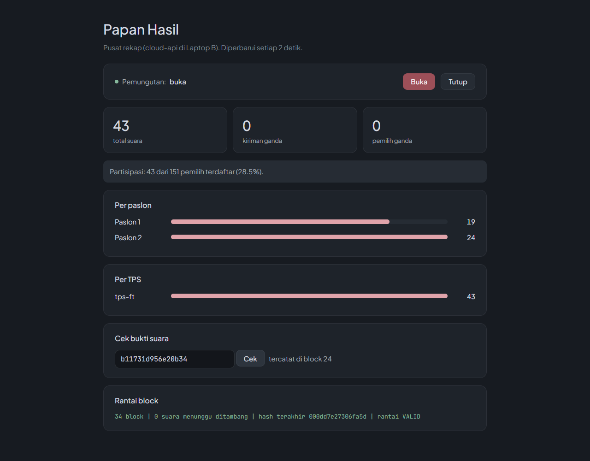
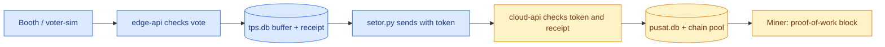
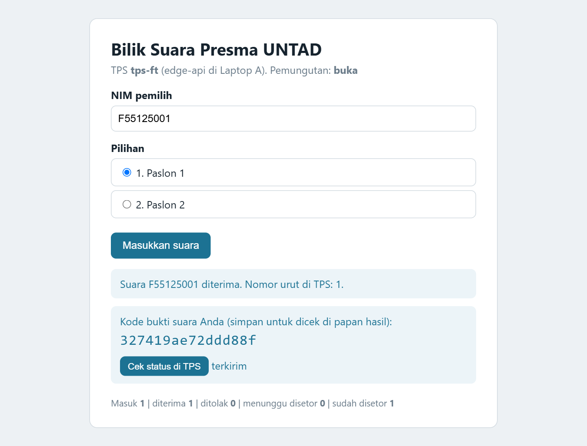

# Presma UNTAD Distributed Voting

A two-laptop voting prototype for the student president (Presma) election at Universitas Tadulako. Votes are collected at a polling station (Laptop A), counted at a tally center (Laptop B), recorded in a proof-of-work hash chain, and every voter gets a receipt code to check that their vote was counted.




> [!NOTE]
> Course project for **Sistem Komputasi Terdistribusi** (S1 Teknik Informatika, Universitas Tadulako, 2026), Kelompok 4. The election case is real; the voter roll is made up and candidate names are not used.

## 📌 Overview

The app keeps the structure of the course's Practicum 5 voting system, so the test tools from the modules (`uji_urutan.py`, `ukur_voting.py`, `tps_gadungan.py`) run unchanged. On top of it:

- The tally center stores every accepted vote in a hash chain with proof of work, adapted from the group's Teknologi Blockchain project. Editing any old vote breaks the chain check.
- **Unique rule, vote receipt:** each accepted vote gets a 16-character receipt code. The tally center recomputes the code from the vote it receives and rejects any mismatch. Voters can look the code up on the tally board to see whether the vote is still at the station, waiting in the pool, or recorded in block N. The board never shows the chosen candidate for a code.

| Item | Value |
| --- | --- |
| Election | Pemilihan Presiden Mahasiswa (Presma) UNTAD |
| Choices | `Paslon 1`, `Paslon 2` |
| Who may vote | Active students in the voter roll (DPT), any intake year. NIM must have a valid format and UNTAD faculty code |
| Polling station | Laptop A, `tps-ft` |
| Tally center | Laptop B |
| Open and close | From the tally board, announced to the station over MQTT |

## ✨ Features

| Area | What it does |
| --- | --- |
| Validation at the station | Rejects closed voting, bad NIM format, unknown faculty code, voters not in the DPT, unknown candidates, and second votes, with the reason shown |
| Buffer and retry | Valid votes are stored at the station (`antre`) and sent in the background, with retries until the tally center answers |
| Token | The tally center only accepts deliveries with the right `X-TPS-Token` (401 otherwise). The receipt is an integrity check, not a second password: anyone holding the token can compute it |
| Idempotent delivery | A vote resent after a lost reply is stored once (same `request_id`) and enters the chain once |
| Lamport clock | Every send and receive carries a Lamport value, logged as JSON lines for `uji_urutan.py` |
| Hash chain | A background miner packs pooled votes into blocks (difficulty from `.env`); the chain is saved to disk and survives restarts |
| Vote receipt | Receipt shown in the booth, checked at the station (`/bukti/{kode}`) and on the board |

## ⚙️ How it works

One vote travels from the booth on Laptop A to a block on Laptop B:



| Laptop | Service | Host port | Role |
| --- | --- | --- | --- |
| A | `edge-api` | 8080 | Booth page `/bilik`, checks, SQLite buffer, sender, receipts |
| A | `voter-sim` | – | Simulated voters, including some invalid ones |
| B | `cloud-api` | 9090 | Board `/papan`, token and receipt checks, tally, hash chain |
| B | `mosquitto` | 1883 | MQTT broker for open/close announcements |



## 🚀 Setup on two laptops

The full run takes about 30 minutes the first time (mostly image downloads). Every command below is for Windows PowerShell, run inside the repository folder unless stated otherwise.

| | Laptop A (polling station) | Laptop B (tally center) |
| --- | --- | --- |
| Runs | `edge-api` (port 8080), `voter-sim` | `cloud-api` (port 9090), `mosquitto` (port 1883) |
| Pages | Booth `http://localhost:8080/bilik` | Board `http://localhost:9090/papan` |
| Needs to reach | Laptop B on 9090 and 1883 | nothing (it only listens) |

### Step 1: Prepare both laptops

1. Install and start [Docker Desktop](https://www.docker.com/products/docker-desktop/) and [Git](https://git-scm.com/download/win). Wait until Docker Desktop says *Engine running*.
2. Clone the repository on both laptops:

   ```powershell
   git clone https://github.com/DrBham/skt-presma-blockchain.git
   cd skt-presma-blockchain
   ```

3. Agree on one group token, a single word such as `presma-k4-rahasia`. Both laptops must use exactly the same value.

### Step 2: Connect the two laptops

1. Connect both laptops to the same network. A phone hotspot works best: campus Wi-Fi often blocks traffic between devices.
2. In Windows Settings → Network & internet → Wi-Fi → the connected network, set **Network profile type** to **Private** on both laptops.
3. On Laptop B, find its address. Note the `IPv4 Address` of the Wi-Fi adapter, for example `192.168.43.120`; the rest of this guide calls it `<LAPTOP_B_IP>`:

   ```powershell
   ipconfig
   ```

4. On Laptop B, open PowerShell **as Administrator** and allow the two ports:

   ```powershell
   New-NetFirewallRule -DisplayName "Presma cloud-api 9090" -Direction Inbound -Protocol TCP -LocalPort 9090 -Action Allow
   New-NetFirewallRule -DisplayName "Presma MQTT 1883" -Direction Inbound -Protocol TCP -LocalPort 1883 -Action Allow
   ```

### Step 3: Start Laptop B (tally center)

1. Create the settings file and set the group token:

   ```powershell
   Copy-Item laptop-b\.env.example laptop-b\.env
   notepad laptop-b\.env
   ```

   Change `TPS_TOKEN=ganti-dengan-token-kelompok` to the group token and save.

2. Start the services:

   ```powershell
   cd laptop-b
   docker compose up --build -d
   docker compose ps
   ```

   Both `cloud-api` and `mosquitto` must show `Up`.

3. Open `http://localhost:9090/papan`. The board shows `Pemungutan: belum dibuka` and `1 block | ... | rantai VALID`.

### Step 4: Start Laptop A (polling station)

1. Create the settings file:

   ```powershell
   Copy-Item laptop-a\.env.example laptop-a\.env
   notepad laptop-a\.env
   ```

   Set `CLOUD_HOST=<LAPTOP_B_IP>` and the same `TPS_TOKEN` as Laptop B, then save.

2. Check that Laptop B is reachable (start Laptop B first):

   ```powershell
   Test-NetConnection <LAPTOP_B_IP> -Port 9090
   Test-NetConnection <LAPTOP_B_IP> -Port 1883
   ```

   Both must end with `TcpTestSucceeded : True`. If not, see [Troubleshooting](#troubleshooting).

3. Start the services:

   ```powershell
   cd laptop-a
   docker compose up --build -d
   docker compose logs -f voter-sim
   ```

   Press `Ctrl+C` to leave the log. Until voting opens, the log shows `DITOLAK: pemungutan belum dibuka`.

### Step 5: Open voting

1. On Laptop B, click **Buka** on the board.
2. On Laptop A, open `http://localhost:8080/bilik`. The header changes to `Pemungutan: buka` within a few seconds (sent over MQTT).
3. `voter-sim` now votes every 2 seconds. The board total rises and new blocks appear in the chain box.

> [!TIP]
> To try everything on one computer, run both folders on the same machine and set `CLOUD_HOST=host.docker.internal` in `laptop-a/.env`. Skip the firewall and network steps.

### Settings

| File | Variable | Example | Purpose |
| --- | --- | --- | --- |
| `laptop-a/.env` | `CLOUD_HOST` | `192.168.43.120` | Address of Laptop B |
| both | `TPS_TOKEN` | group secret | Must be identical on both laptops |
| `laptop-a/.env` | `TPS_ID` | `tps-ft` | Polling station name |
| `laptop-a/.env` | `TIMEOUT_S`, `MAKS_COBA` | `1`, `3` | Wait per send and attempts per round |
| `laptop-a/.env` | `SETOR_TIAP_S`, `SETOR_MAKS` | `2`, `20` | Send interval and batch size |
| `laptop-b/.env` | `DIFFICULTY` | `3` | Leading zeros required in a block hash |
| `laptop-b/.env` | `TAMBANG_TIAP_S` | `3` | Seconds between mining rounds |

`.env` files are ignored by git so the token never ends up in the repository.

## 🎯 Trying every required ability

Run the checks in this order; it matches the four demo points of the assignment. Commands marked **A** run on Laptop A inside `laptop-a`, **B** on Laptop B inside `laptop-b`. Record each output for the report.

### Ability 1: a vote from Laptop A reaches Laptop B

1. **A:** in the booth, enter NIM `F55125001`, choose **Paslon 1**, click **Masukkan suara**.
2. The booth shows the receipt code. Within about 5 seconds the board on **B** counts the vote, and the receipt check shows `tercatat di block N`.

`voter-sim` picks voters at random, so a NIM may already be used. If the booth answers `pemilih sudah memilih`, try another NIM from the roll, such as `A12119001` or `C30124007`.

### Ability 2: Laptop B's address comes from a settings file

**A:** show the file during the demo; the address is not written in the code.

```powershell
Get-Content .env
```

### Ability 3: event order with Lamport clocks

**A:** with voting open for at least a minute:

```powershell
docker compose exec edge-api python uji_urutan.py
```

```text
Timestamp fisik : LULUS
Lamport clock   : LULUS
```

The script pulls Laptop B's events from `http://<LAPTOP_B_IP>:9090/event`, so B must be reachable. To see one vote's full path in time order, run `docker compose exec edge-api python gabung_log.py lamport <seq>`.

Group-designed test, restart during voting:

1. **B:** `docker compose restart cloud-api`
2. Wait 15 seconds, then run `uji_urutan.py` again on **A**: still `LULUS`.
3. On the board: `kiriman ganda 0`, `pemilih ganda 0`, chain `VALID`. Votes queued during the restart were delivered and none were counted twice.

### Ability 4: checks and buffer at Laptop A

**A:** in the booth, try each rejected case and note the reason shown:

| NIM | Choice | Expected reason |
| --- | --- | --- |
| `Z55125001` | Paslon 1 | `Kode Fakultas 'Z' tidak terdaftar di UNTAD!` |
| `F55125099` | Paslon 1 | `pemilih tidak terdaftar` (not in the DPT) |
| `F55125001` (again) | Paslon 2 | `pemilih sudah memilih` |

Accepted votes wait at the station as `antre` until they are sent. The footer of the booth shows `menunggu disetor` (queued) and `sudah disetor` (sent).

### Ability 5: Laptop B stores, counts, and shows results

**B:** the board shows the total, votes per candidate, per station, participation, and the chain. The raw tally is at `http://localhost:9090/rekap`.

### Ability 6: only deliveries with the right token are accepted

**A:**

```powershell
docker compose exec edge-api python tps_gadungan.py
```

```text
suara palsu 1 -> 401 {"detail":"token TPS salah"}
```

### Ability 7: performance

Measure on fresh data, without `voter-sim`:

1. **A:** `docker compose down -v`
2. **B:** `docker compose down -v`, then `docker compose up -d`, then click **Buka** on the board.
3. **A:**

   ```powershell
   docker compose up -d edge-api
   docker compose exec edge-api python ukur_voting.py beban 150
   ```

   The output lists throughput to Laptop B, latency p50 and p95, and how many votes the station rejected. Our single-machine run gave 8.1 votes per second, p50 8.35 s, p95 16.97 s.

4. **A:** `docker compose up -d voter-sim` to resume simulated voting.

### Ability 8 and the unique rule: network cut of at least 60 seconds

1. Record the counts before the cut:

   ```powershell
   Invoke-RestMethod http://localhost:8080/status   # on A
   Invoke-RestMethod http://localhost:9090/rekap    # on B
   ```

2. Vote once in the booth on **A** with an unused NIM, for example `C30125010`, and copy the receipt code.
3. Cut the connection: turn off Wi-Fi on Laptop A, or switch off the hotspot. Keep it off for at least 60 seconds.
4. During the cut:
   - **A:** run the `/status` command again. `antre` (queued) keeps growing because `voter-sim` keeps voting and the station keeps accepting.
   - **A:** in the booth, **Cek status di TPS** shows `antre di TPS`.
   - **B:** the receipt check on the board shows `belum diterima pusat rekap`.
5. Reconnect. Within about 20 seconds:
   - **A:** `antre` drops back to 0 and `terkirim` equals `diterima`.
   - **B:** the board still shows `kiriman ganda 0` and `pemilih ganda 0`, the chain is `VALID`, and the receipt check shows `tercatat di block N`.

Write the three sets of numbers (before, during, after) in the report. No vote is lost and none is counted twice.

### Extra: tamper detection on the chain

**B:** change one stored vote without recomputing the hash, then restart:

```powershell
docker compose exec cloud-api python ubah_rantai.py 1
docker compose restart cloud-api
```

The board's chain box turns red: `rantai TIDAK VALID, block pertama rusak: 1`. Run `docker compose down -v` on both laptops afterwards to start clean.

### Stopping and resetting

| Goal | Command (in each laptop folder) |
| --- | --- |
| Stop, keep data | `docker compose down` |
| Stop and delete all votes and the chain | `docker compose down -v` |
| Follow logs | `docker compose logs -f` |

### Troubleshooting

| Symptom | Cause and fix |
| --- | --- |
| Board total stays 0, `edge-api` log shows `401 token TPS salah` | `TPS_TOKEN` differs between the two `.env` files. Make them identical and run `docker compose up -d --force-recreate` on both |
| Booth stays `belum ada pengumuman` after **Buka** | Laptop A cannot reach MQTT on 1883. Check the firewall rule and `Test-NetConnection <LAPTOP_B_IP> -Port 1883` |
| `edge-api` log shows `gagal terhubung` or `timeout` | Wrong `CLOUD_HOST`, B not running, or port 9090 blocked. Check `Test-NetConnection` |
| `Bind for 0.0.0.0:8080 failed: port is already allocated` | Another container (for example the old practicum) uses the port. Stop it with `docker ps` and `docker stop <name>` |
| `voter-sim` shows `Name or service not known` | `edge-api` did not start. Run `docker compose up -d` again and check `docker compose ps` |
| `TcpTestSucceeded : False` on the same hotspot | Network profile is Public, or the hotspot isolates devices. Set Private, or try another hotspot |

Unit tests run outside Docker:

```powershell
python -m pip install fastapi==0.141.1 httpx==0.28.1 paho-mqtt==2.1.0 pytest
python -m pytest tests
```

```text
21 passed
```

Results from our single-machine run are in [docs/uji/hasil-uji-satu-mesin.md](docs/uji/hasil-uji-satu-mesin.md).

## 🗂️ Project structure

```text
├── laptop-a/
│   ├── edge-api/        # booth, checks (nim.py, daftar.py), buffer, sender, receipts (bukti.py)
│   └── voter-sim/       # simulated voters
├── laptop-b/
│   ├── cloud-api/       # board, token and receipt checks, tally, hash chain (rantai.py, ubah_rantai.py demo)
│   └── mosquitto/       # MQTT broker config
├── tests/               # pytest suite
└── docs/
    ├── superpowers/     # design and implementation plan
    └── uji/             # test evidence
```

## ⚠️ Limitations

- The voter roll is fixed in `daftar.py`; a real election would load the DPT from the university system.
- The chain runs only on Laptop B; it proves later edits, not who ran the tally center.
- Votes in the chain include the NIM and choice, so the chain is not a secret ballot.
- Mining difficulty is fixed and is not adjusted to block time.

## 📄 License

[MIT](LICENSE). Built as coursework for Sistem Komputasi Terdistribusi at Universitas Tadulako; anyone may study, reuse, and extend it.
