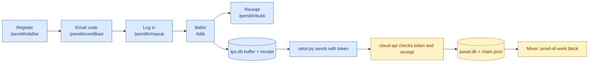
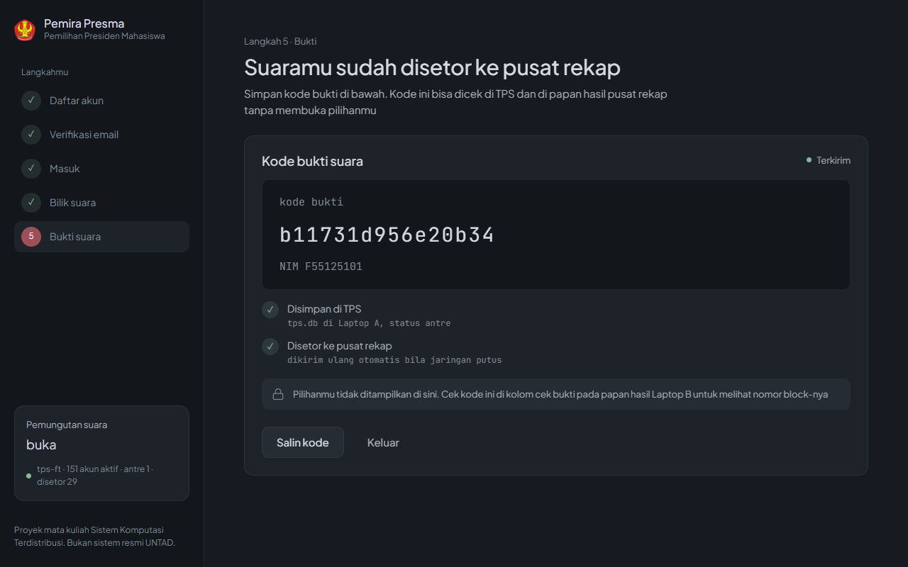

# Presma UNTAD Distributed Voting

A two-laptop voting prototype for the student president (Presma) election at Universitas Tadulako. Students create an account at the polling station (Laptop A), confirm it with a code sent to their campus email, log in, and vote on a paper-style ballot. Votes are counted at a tally center (Laptop B), recorded in a proof-of-work hash chain, and every voter gets a receipt code to check that their vote was counted.


> [!NOTE]
> Course project for **Sistem Komputasi Terdistribusi** (S1 Teknik Informatika, Universitas Tadulako, 2026), Kelompok 4. The election case is real; the simulated voter accounts are made up and candidate names are not used.

## 📌 Overview

The app keeps the structure of the course's Practicum 5 voting system, so the test tools from the modules (`uji_urutan.py`, `ukur_voting.py`, `tps_gadungan.py`) still run. On top of it:

- **Voter login (group feature).** There is no voter roll. Any student with a valid UNTAD NIM registers at the station; the account becomes active only after the student types the 6-digit code sent to `NIM@untad.ac.id`. The booth accepts a vote only from a logged-in session.
- **Hash chain.** The tally center stores every accepted vote in a hash chain with proof of work, adapted from the group's Teknologi Blockchain project. Editing any old vote breaks the chain check.
- **Unique rule, vote receipt.** Each accepted vote gets a 16-character receipt code. The tally center recomputes the code from the vote it receives and rejects any mismatch. Voters look the code up on the board to see whether the vote is still at the station, waiting in the pool, or recorded in block N. The board never shows the chosen candidate for a code.

| Item | Value |
| --- | --- |
| Election | Pemilihan Presiden Mahasiswa (Presma) UNTAD |
| Choices | `Paslon 1`, `Paslon 2` |
| Who may vote | Any student whose NIM has a valid format (1 capital letter + 7–8 digits) and an UNTAD faculty code (`A B C D E F G K L N P`), after confirming the campus email |
| Polling station | Laptop A, `tps-ft` |
| Tally center | Laptop B |
| Open and close | From the tally board, announced to the station over MQTT |

## ✨ Features

| Area | What it does |
| --- | --- |
| Voter accounts | Register with NIM and password (min. 8 characters); the email is always `NIM@untad.ac.id`. Password and voter code are stored only as scrypt hashes |
| Email code | A 6-digit voter code goes to Mailpit on Laptop A (or to the `edge-api` log if mail fails). 5 wrong tries burn the code; a new one can be sent after 60 seconds |
| Login and session | NIM + password + voter code open a 15-minute session. The code is burned once the vote is accepted |
| Paper ballot | Two ballot cards, then a **Setuju / Batal** confirm dialog before the vote is sent |
| Validation at the station | Rejects closed voting, bad NIM format, unknown faculty code, unknown accounts, requests without a session, invalid choices, and second votes, with the reason shown |
| Buffer and retry | Valid votes are stored at the station (`antre`) and sent in the background, with retries until the tally center answers |
| Token | The tally center only accepts deliveries with the right `X-TPS-Token` (401 otherwise). The receipt is an integrity check, not a second password: anyone holding the token can compute it |
| Idempotent delivery | A vote resent after a lost reply is stored once (same `request_id`) and enters the chain once |
| Lamport clock | Every send and receive carries a Lamport value, logged as JSON lines for `uji_urutan.py` |
| Hash chain | A background miner packs pooled votes into blocks (difficulty from `.env`); the chain is saved to disk and survives restarts |
| Participation | Each delivery carries the station's number of active accounts (`terdaftar`); the board divides turnout by that number |
| Vote receipt | Receipt page after voting, checked at the station (`/bukti/{kode}`) and on the board |

## ⚙️ How it works

A voter goes through five pages on Laptop A, then the vote travels to a block on Laptop B:



| Laptop | Service | Host port | Role |
| --- | --- | --- | --- |
| A | `edge-api` | 8080 | Voter pages, accounts and sessions, checks, SQLite buffer, sender, receipts |
| A | `mailpit` | 1025, 8025 | Local mail server; inbox at `http://localhost:8025` |
| A | `voter-sim` | – | Logs in with 150 simulated accounts and votes, including some invalid requests |
| B | `cloud-api` | 9090 | Board `/papan`, token and receipt checks, tally, hash chain |
| B | `mosquitto` | 1883 | MQTT broker for open/close announcements |




## 🚀 Setup on two laptops

The full run takes about 30 minutes the first time (mostly image downloads). Every command below is for Windows PowerShell, run inside the repository folder unless stated otherwise.

| | Laptop A (polling station) | Laptop B (tally center) |
| --- | --- | --- |
| Runs | `edge-api` (8080), `mailpit` (1025, 8025), `voter-sim` | `cloud-api` (9090), `mosquitto` (1883) |
| Pages | Voter pages `http://localhost:8080/pemilih/daftar`, inbox `http://localhost:8025` | Board `http://localhost:9090/papan` |
| Needs to reach | Laptop B on 9090 and 1883 | nothing (it only listens) |

### Step 1: Prepare both laptops

1. Install and start [Docker Desktop](https://www.docker.com/products/docker-desktop/) and [Git](https://git-scm.com/download/win). Wait until Docker Desktop says *Engine running*.
2. Clone the repository on both laptops:

   ```powershell
   git clone https://github.com/DrBham/skt-presma-blockchain.git
   cd skt-presma-blockchain
   ```

3. Agree on one group token, a single word such as `presma-k4-rahasia`. Both laptops must use exactly the same value.

### Step 2: Connect the two laptops

1. Connect both laptops to the same network. A phone hotspot works best: campus Wi-Fi often blocks traffic between devices.
2. In Windows Settings → Network & internet → Wi-Fi → the connected network, set **Network profile type** to **Private** on both laptops.
3. On Laptop B, find its address. Note the `IPv4 Address` of the Wi-Fi adapter, for example `192.168.43.120`; the rest of this guide calls it `<LAPTOP_B_IP>`:

   ```powershell
   ipconfig
   ```

4. On Laptop B, open PowerShell **as Administrator** and allow the two ports. Laptop A needs no firewall rule: Mailpit is only opened from Laptop A itself.

   ```powershell
   New-NetFirewallRule -DisplayName "Presma cloud-api 9090" -Direction Inbound -Protocol TCP -LocalPort 9090 -Action Allow
   New-NetFirewallRule -DisplayName "Presma MQTT 1883" -Direction Inbound -Protocol TCP -LocalPort 1883 -Action Allow
   ```

### Step 3: Start Laptop B (tally center)

1. Create the settings file and set the group token:

   ```powershell
   Copy-Item laptop-b\.env.example laptop-b\.env
   notepad laptop-b\.env
   ```

   Change `TPS_TOKEN=ganti-dengan-token-kelompok` to the group token and save.

2. Start the services:

   ```powershell
   cd laptop-b
   docker compose up --build -d
   docker compose ps
   ```

   Both `cloud-api` and `mosquitto` must show `Up`.

3. Open `http://localhost:9090/papan`. The board shows `Pemungutan: belum dibuka` and `1 block | ... | rantai VALID`.

### Step 4: Start Laptop A (polling station)

1. Create the settings file:

   ```powershell
   Copy-Item laptop-a\.env.example laptop-a\.env
   notepad laptop-a\.env
   ```

   Set `CLOUD_HOST=<LAPTOP_B_IP>` and the same `TPS_TOKEN` as Laptop B, then save. Leave `SIM_PASSWORD` and `SIM_KODE` as they are unless you want other values for the simulated accounts.

2. Check that Laptop B is reachable (start Laptop B first):

   ```powershell
   Test-NetConnection <LAPTOP_B_IP> -Port 9090
   Test-NetConnection <LAPTOP_B_IP> -Port 1883
   ```

   Both must end with `TcpTestSucceeded : True`. If not, see [Troubleshooting](#troubleshooting).

3. Start the services:

   ```powershell
   cd laptop-a
   docker compose up --build -d
   docker compose ps
   docker compose logs -f voter-sim
   ```

   `edge-api`, `mailpit`, and `voter-sim` must show `Up`. On start, `edge-api` creates 150 active simulated accounts. Press `Ctrl+C` to leave the log. Until voting opens, the log shows lines such as `voter -> A12119007 masuk` followed by `DITOLAK: pemungutan belum dibuka`.

### Step 5: Open voting

1. On Laptop B, click **Buka** on the board.
2. On Laptop A, open `http://localhost:8080/pemilih/daftar`. Within a few seconds the **Pemungutan suara** box in the left rail changes to `buka` (sent over MQTT).
3. `voter-sim` now votes every 2 seconds. The board total rises and new blocks appear in the chain box.

> [!TIP]
> To try everything on one computer, run both folders on the same machine and set `CLOUD_HOST=host.docker.internal` in `laptop-a/.env`. Skip the firewall and network steps.

### Settings

| File | Variable | Example | Purpose |
| --- | --- | --- | --- |
| `laptop-a/.env` | `CLOUD_HOST` | `192.168.43.120` | Address of Laptop B |
| both | `TPS_TOKEN` | group secret | Must be identical on both laptops |
| `laptop-a/.env` | `TPS_ID` | `tps-ft` | Polling station name |
| `laptop-a/.env` | `TIMEOUT_S`, `MAKS_COBA` | `1`, `3` | Wait per send and attempts per round |
| `laptop-a/.env` | `SETOR_TIAP_S`, `SETOR_MAKS` | `2`, `20` | Send interval and batch size |
| `laptop-a/.env` | `SIM_PASSWORD`, `SIM_KODE` | `pemilih-simulasi`, `123456` | Password and voter code of the 150 simulated accounts, used by `voter-sim` and `ukur_voting.py` |
| `laptop-a/docker-compose.yml` | `MAIL_HOST`, `MAIL_PORT` | `mailpit`, `1025` | SMTP server for voter codes. If sending fails, the code is printed in the `edge-api` log |
| `laptop-b/.env` | `DIFFICULTY` | `3` | Leading zeros required in a block hash |
| `laptop-b/.env` | `TAMBANG_TIAP_S` | `3` | Seconds between mining rounds |

`.env` files are ignored by git so the token never ends up in the repository.

## 🎯 Trying every required ability

Run the checks in this order; it matches the four demo points of the assignment. Commands marked **A** run on Laptop A inside `laptop-a`, **B** on Laptop B inside `laptop-b`. Record each output for the report.

> [!IMPORTANT]
> The simulated accounts use NIMs `A121`, `C301`, or `F551` + year `19`, `22`–`25` + `001`–`010` (for example `F55125001`). Pick a NIM outside that set when you register by hand, such as `F55125101`; otherwise the page answers `NIM ini sudah punya akun. Silakan masuk`.

### Ability 1: a vote from Laptop A reaches Laptop B

All steps on **A** except the last.

1. Open `http://localhost:8080/pemilih/daftar`. Enter NIM `F55125101`; the email field fills itself with `F55125101@untad.ac.id`. Type a password of at least 8 characters in both password fields and click **Daftar dan kirim kode**. The page changes to **Cek email kampusmu**.
2. Open `http://localhost:8025`, open the mail **Kode pemilih Pemira Presma**, and note the 6-digit code. Type it in the six boxes. The code is checked as soon as the sixth digit is in, and the page moves to **Masuk ke bilik suara** with `Akun aktif. Simpan kode pemilih ini untuk masuk dan memilih`.
3. Enter the NIM, the password, and the same 6-digit code, then click **Masuk dan buka bilik**. The ballot opens with `Masuk sebagai F55125101`.
4. Click the **Paslon 1** card, click **Kirim suara**, then **Setuju, kirim suara** in the dialog (**Batal, pilih ulang** goes back to the ballot). The receipt page shows the 16-character code with the tag `Antre di TPS`, which turns into `Terkirim` within a few seconds.
5. **B:** paste the code into **Cek bukti suara** on the board and click **Cek**: `tercatat di block N`.

If Mailpit is not running, the code is in the log: `docker compose logs edge-api | Select-String "KODE PEMILIH"`.

### Ability 2: Laptop B's address comes from a settings file

**A:** show the file during the demo; the address is not written in the code.

```powershell
Get-Content .env
```

### Ability 3: event order with Lamport clocks

**A:** with voting open for at least a minute:

```powershell
docker compose exec edge-api python uji_urutan.py
```

```text
Timestamp fisik : LULUS
Lamport clock   : LULUS
```

The script pulls Laptop B's events from `http://<LAPTOP_B_IP>:9090/event`, so B must be reachable. To see one vote's full path in time order, run `docker compose exec edge-api python gabung_log.py lamport <seq>`.

Group-designed test, restart during voting:

1. **B:** `docker compose restart cloud-api`
2. Wait 15 seconds, then run `uji_urutan.py` again on **A**: still `LULUS`.
3. On the board: `kiriman ganda 0`, `pemilih ganda 0`, chain `VALID`. Votes queued during the restart were delivered and none were counted twice.

### Ability 4: checks and buffer at Laptop A

**A:** try each case and note the reason shown. The NIM checks run in the page as you type and again on the server.

| Case | Where | Expected reason |
| --- | --- | --- |
| NIM `Z55125001` | Register page | `Kode fakultas 'Z' tidak terdaftar di UNTAD` (server: `Kode Fakultas 'Z' tidak terdaftar di UNTAD!`) |
| NIM `F5512` | Register page | `1 huruf diikuti 7 atau 8 angka` (server: `format NIM salah (1 huruf kapital + 7-8 digit)`) |
| NIM `F55125199` (never registered), any password and code | Login page | `NIM atau password salah` |
| Log in again as `F55125101` after voting | Login page | Opens the receipt page instead of the ballot: the account has already voted |
| Vote without logging in | PowerShell, below | `belum masuk atau sesi habis` |
| Click **Tutup** on the board, then open the ballot | Ballot page | `Pemungutan suara sudah ditutup. Suara baru tidak diterima lagi` (server: `pemungutan sudah ditutup`) |
| Choice `9`, second vote by the same account | `voter-sim` log | `DITOLAK: pilihan tidak sah`, `DITOLAK: pemilih sudah memilih` |

```powershell
Invoke-RestMethod -Method Post -Uri http://localhost:8080/suara -ContentType application/json -Body '{"pilihan":1}'
```

```text
diterima alasan                      seq bukti
-------- ------                      --- -----
   False belum masuk atau sesi habis
```

Click **Buka** again after the closed-voting check. Accepted votes wait at the station as `antre` until they are sent; `Invoke-RestMethod http://localhost:8080/status` shows `antre` and `terkirim`, and the left rail of the voter pages shows `antre N · disetor N`.

### Ability 5: Laptop B stores, counts, and shows results

**B:** the board shows the total, votes per candidate, per station, the chain, and participation as `Partisipasi: X dari Y pemilih terdaftar`. `Y` is the number of active accounts each station reported with its last delivery (150 simulated accounts plus the ones you registered). The raw tally is at `http://localhost:9090/rekap`.

The board is split in two columns. The left column shows the running total with the vote rate per minute over the last five minutes, both Paslon side by side on one bar, the count per station, and the latest deliveries (station, sequence number, block, time; never the choice). The right column holds the receipt check with its three stages, the last five blocks of the chain (click a block for its mining time and hash check), and the duplicate counters. **Tutup** asks for confirmation first, and pressing `/` jumps to the receipt field.

### Ability 6: only deliveries with the right token are accepted

**A:**

```powershell
docker compose exec edge-api python tps_gadungan.py
```

```text
suara palsu 1 -> 401 {"detail":"token TPS salah"}
```

### Ability 7: performance

Measure on fresh data, without `voter-sim`:

1. **A:** `docker compose down -v`
2. **B:** `docker compose down -v`, then `docker compose up -d`, then click **Buka** on the board.
3. **A:**

   ```powershell
   docker compose up -d edge-api
   docker compose exec edge-api python ukur_voting.py beban 150
   ```

   The script first logs in the 150 simulated accounts with `SIM_PASSWORD` and `SIM_KODE` (the first output line reads `Akun simulasi masuk` with `150`), outside the timed part. It then lists throughput to Laptop B, latency p50 and p95, and how many votes the station rejected. Our single-machine run gave 8.1 votes per second, p50 7.98 s, p95 16.30 s, 0 rejected.

4. **A:** `docker compose up -d` to start `mailpit` and `voter-sim` again.

### Ability 8 and the unique rule: network cut of at least 60 seconds

1. Record the counts before the cut:

   ```powershell
   Invoke-RestMethod http://localhost:8080/status   # on A
   Invoke-RestMethod http://localhost:9090/rekap    # on B
   ```

2. On **A**, register, verify, and log in as a new voter, for example `F55125102` (same steps as Ability 1). Vote, then keep the receipt page open and copy the code.
3. Cut the connection: turn off Wi-Fi on Laptop A, or switch off the hotspot. Keep it off for at least 60 seconds.
4. During the cut:
   - **A:** run the `/status` command again. `antre` (queued) keeps growing because `voter-sim` keeps voting and the station keeps accepting.
   - **A:** the receipt page keeps the tag `Antre di TPS`; `Invoke-RestMethod http://localhost:8080/bukti/<code>` returns `antre di TPS`.
   - **B:** the receipt check on the board shows `belum diterima pusat rekap`.
5. Reconnect. Within about 20 seconds:
   - **A:** `antre` drops back to 0 and `terkirim` equals `diterima`. The receipt page switches to `Terkirim`.
   - **B:** the board still shows `kiriman ganda 0` and `pemilih ganda 0`, the chain is `VALID`, and the receipt check shows `tercatat di block N`.

Write the three sets of numbers (before, during, after) in the report. No vote is lost and none is counted twice. Registration and login also work during the cut, because accounts and Mailpit live on Laptop A.

### Extra: tamper detection on the chain

**B:** change one stored vote without recomputing the hash, then restart:

```powershell
docker compose exec cloud-api python ubah_rantai.py 1
docker compose restart cloud-api
```

The board's chain box turns red: `rantai TIDAK VALID, block pertama rusak: 1`. Run `docker compose down -v` on both laptops afterwards to start clean.

### Stopping and resetting

| Goal | Command (in each laptop folder) |
| --- | --- |
| Stop, keep data | `docker compose down` |
| Stop and delete all votes, accounts, and the chain | `docker compose down -v` |
| Follow logs | `docker compose logs -f` |

### Troubleshooting

| Symptom | Cause and fix |
| --- | --- |
| Board total stays 0, `edge-api` log shows `401 token TPS salah` | `TPS_TOKEN` differs between the two `.env` files. Make them identical and run `docker compose up -d --force-recreate` on both |
| Left rail stays `belum ada pengumuman` after **Buka** | Laptop A cannot reach MQTT on 1883. Check the firewall rule and `Test-NetConnection <LAPTOP_B_IP> -Port 1883` |
| `edge-api` log shows `gagal terhubung` or `timeout` | Wrong `CLOUD_HOST`, B not running, or port 9090 blocked. Check `Test-NetConnection` |
| No mail at `http://localhost:8025` | `mailpit` is not running. Check `docker compose ps`, or read the code from `docker compose logs edge-api \| Select-String "KODE PEMILIH"` |
| After restarting `edge-api`, the ballot sends you back to the login page and `voter-sim` shows `belum masuk atau sesi habis` | Sessions live in `edge-api` memory, so a restart logs everyone out. Log in again; `voter-sim` logs in again by itself on the next vote. Sessions also end after 15 minutes |
| `ukur_voting.py` stops with `gagal masuk ... Cek SIM_PASSWORD dan SIM_KODE` | Simulated accounts are created once and keep the values from the first start. After changing `SIM_PASSWORD` or `SIM_KODE`, run `docker compose down -v` on A |
| `Bind for 0.0.0.0:8080 failed: port is already allocated` | Another container (for example the old practicum) uses the port. Stop it with `docker ps` and `docker stop <name>` |
| `voter-sim` shows `gagal menghubungi edge-api` | `edge-api` did not start. Run `docker compose up -d` again and check `docker compose ps` |
| `TcpTestSucceeded : False` on the same hotspot | Network profile is Public, or the hotspot isolates devices. Set Private, or try another hotspot |

### Unit tests

The tests run outside Docker, in a virtual environment at the repository root:

```powershell
python -m venv .venv
.venv\Scripts\python -m pip install -r laptop-a\edge-api\requirements.txt -r laptop-b\cloud-api\requirements.txt pytest
.venv\Scripts\python -m pytest tests
```

```text
35 passed
```

Results from an earlier single-machine run are in [docs/uji/hasil-uji-satu-mesin.md](docs/uji/hasil-uji-satu-mesin.md).

## 🗂️ Project structure

```text
├── laptop-a/
│   ├── edge-api/        # station API: accounts and sessions (akun.py), NIM checks (nim.py), buffer, sender, receipts
│   │   ├── halaman/     #   voter pages: register, verify, log in, ballot, receipt
│   │   └── static/      #   shared style and page script
│   └── voter-sim/       # simulated voters that log in, then vote
├── laptop-b/
│   ├── cloud-api/       # board, token and receipt checks, tally, hash chain (rantai.py, ubah_rantai.py demo)
│   └── mosquitto/       # MQTT broker config
├── tests/               # pytest suite
└── docs/
    ├── images/          # screenshots used in this README
    ├── superpowers/     # designs (incl. voter login) and implementation plan
    └── uji/             # test evidence
```

The voter login design is in [docs/superpowers/specs/2026-10-29-skt-login-pemilih-design.md](docs/superpowers/specs/2026-10-29-skt-login-pemilih-design.md).

## ⚠️ Limitations

- Accounts and sessions live only at the station (Laptop A). A second station would have its own accounts, and sessions are lost when `edge-api` restarts.
- There is no feed from university data. The email code proves only that someone can read `NIM@untad.ac.id`, not that the student is active. In this demo the mail never leaves Laptop A: Mailpit catches it.
- The 150 simulated accounts share one password and one voter code from `.env`.
- The chain runs only on Laptop B; it proves later edits, not who ran the tally center.
- Votes in the chain include the NIM and choice, so the chain is not a secret ballot.
- Mining difficulty is fixed and is not adjusted to block time.

## 📄 License

[MIT](LICENSE). Built as coursework for Sistem Komputasi Terdistribusi at Universitas Tadulako; anyone may study, reuse, and extend it.
