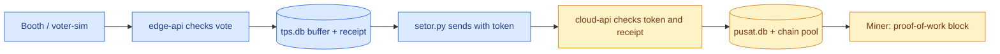

# Presma UNTAD Distributed Voting

A two-laptop voting prototype for the student president (Presma) election at Universitas Tadulako. Votes are collected at a polling station (Laptop A), counted at a tally center (Laptop B), recorded in a proof-of-work hash chain, and every voter gets a receipt code to check that their vote was counted.


> [!NOTE]
> Course project for **Sistem Komputasi Terdistribusi** (S1 Teknik Informatika, Universitas Tadulako, 2026), Kelompok 4. The election case is real; the voter roll is made up and candidate names are not used.

## 📌 Overview

The app keeps the structure of the course's Practicum 5 voting system, so the test tools from the modules (`uji_urutan.py`, `ukur_voting.py`, `tps_gadungan.py`) run unchanged. On top of it:

- The tally center stores every accepted vote in a hash chain with proof of work, adapted from the group's Teknologi Blockchain project. Editing any old vote breaks the chain check.
- **Unique rule, vote receipt:** each accepted vote gets a 16-character receipt code. The tally center recomputes the code from the vote it receives and rejects any mismatch. Voters can look the code up on the tally board to see whether the vote is still at the station, waiting in the pool, or recorded in block N. The board never shows the chosen candidate for a code.

| Item | Value |
| --- | --- |
| Election | Pemilihan Presiden Mahasiswa (Presma) UNTAD |
| Choices | `Paslon 1`, `Paslon 2` |
| Who may vote | Active students in the voter roll (DPT), any intake year. NIM must have a valid format and UNTAD faculty code |
| Polling station | Laptop A, `tps-ft` |
| Tally center | Laptop B |
| Open and close | From the tally board, announced to the station over MQTT |

## ✨ Features

| Area | What it does |
| --- | --- |
| Validation at the station | Rejects closed voting, bad NIM format, unknown faculty code, voters not in the DPT, unknown candidates, and second votes, with the reason shown |
| Buffer and retry | Valid votes are stored at the station (`antre`) and sent in the background, with retries until the tally center answers |
| Token | The tally center only accepts deliveries with the right `X-TPS-Token` (401 otherwise) |
| Idempotent delivery | A vote resent after a lost reply is stored once (same `request_id`) and enters the chain once |
| Lamport clock | Every send and receive carries a Lamport value, logged as JSON lines for `uji_urutan.py` |
| Hash chain | A background miner packs pooled votes into blocks (difficulty from `.env`); the chain is saved to disk and survives restarts |
| Vote receipt | Receipt shown in the booth, checked at the station (`/bukti/{kode}`) and on the board |

## ⚙️ How it works

One vote travels from the booth on Laptop A to a block on Laptop B:



| Laptop | Service | Host port | Role |
| --- | --- | --- | --- |
| A | `edge-api` | 8080 | Booth page `/bilik`, checks, SQLite buffer, sender, receipts |
| A | `voter-sim` | – | Simulated voters, including some invalid ones |
| B | `cloud-api` | 9090 | Board `/papan`, token and receipt checks, tally, hash chain |
| B | `mosquitto` | 1883 | MQTT broker for open/close announcements |


## 🚀 Getting started

Needs Docker Desktop on both laptops, connected to the same network (a phone hotspot works best).

1. Clone the repo on both laptops:

   ```powershell
   git clone https://github.com/DrBham/skt-presma-blockchain.git
   cd skt-presma-blockchain
   ```

2. Copy the example settings and put the **same** group token in both:

   ```powershell
   Copy-Item laptop-a\.env.example laptop-a\.env   # Laptop A
   Copy-Item laptop-b\.env.example laptop-b\.env   # Laptop B
   ```

   On Laptop A, set `CLOUD_HOST` to Laptop B's IPv4 address from `ipconfig`.

3. On Laptop B, allow ports 9090 and 1883 in Windows Defender Firewall, then start it:

   ```powershell
   cd laptop-b
   docker compose up --build -d
   ```

4. On Laptop A:

   ```powershell
   cd laptop-a
   docker compose up --build -d
   ```

5. Open `http://<LAPTOP_B_IP>:9090/papan`, click **Buka**, then vote at `http://localhost:8080/bilik` on Laptop A.

> [!TIP]
> To try everything on one computer, start both folders on the same machine and set `CLOUD_HOST=host.docker.internal` in `laptop-a/.env`.

### Settings

| File | Variable | Example | Purpose |
| --- | --- | --- | --- |
| `laptop-a/.env` | `CLOUD_HOST` | `192.168.137.1` | Address of Laptop B |
| both | `TPS_TOKEN` | group secret | Must be identical on both laptops |
| `laptop-a/.env` | `TPS_ID` | `tps-ft` | Polling station name |
| `laptop-a/.env` | `SETOR_TIAP_S`, `SETOR_MAKS` | `2`, `20` | Send interval and batch size |
| `laptop-b/.env` | `DIFFICULTY` | `3` | Leading zeros required in a block hash |
| `laptop-b/.env` | `TAMBANG_TIAP_S` | `3` | Seconds between mining rounds |

`.env` files are ignored by git so the token never ends up in the repository.

## 🎯 Demo and tests

Commands run on Laptop A from the `laptop-a` folder.

| Ability | How to show it |
| --- | --- |
| Vote reaches Laptop B | Vote in the booth; the board count rises |
| Address from settings | Show `CLOUD_HOST` in `laptop-a/.env` |
| Lamport order | `docker compose exec edge-api python uji_urutan.py` → `Lamport clock : LULUS` |
| Reject at the station | Vote with `Z55125001` (faculty code) or `F55125099` (not in DPT) |
| Token | `docker compose exec edge-api python tps_gadungan.py` → `401` |
| Performance | `docker compose exec edge-api python ukur_voting.py beban 150` on fresh volumes |
| Network cut ≥60 s | Unplug for a minute; `antre` grows on A, then drains; board shows no duplicates and the chain stays valid |
| Vote receipt | Copy the receipt from the booth and check it on the board before, during, and after the cut |

A leaked token is still not enough to forge votes: `TOKEN_GADUNGAN=<token> python tps_gadungan.py` gets `422 bukti tidak cocok dengan isi suara`.

Results from a single-machine run (outage simulated by stopping `cloud-api` for 65 seconds) are in [docs/uji/hasil-uji-satu-mesin.md](docs/uji/hasil-uji-satu-mesin.md): 150 votes delivered at 8.1 votes per second (latency p50 8.35 s, p95 16.97 s), no lost or duplicate votes after the outage, and a valid chain. The two-laptop run still has to be done by the group.

Unit tests run outside Docker:

```powershell
python -m pip install fastapi==0.141.1 httpx==0.28.1 paho-mqtt==2.1.0 pytest
python -m pytest tests
```

```text
17 passed
```

## 🗂️ Project structure

```text
├── laptop-a/
│   ├── edge-api/        # booth, checks (nim.py, daftar.py), buffer, sender, receipts (bukti.py)
│   └── voter-sim/       # simulated voters
├── laptop-b/
│   ├── cloud-api/       # board, token and receipt checks, tally, hash chain (rantai.py)
│   └── mosquitto/       # MQTT broker config
├── tests/               # pytest suite
└── docs/
    ├── superpowers/     # design and implementation plan
    └── uji/             # test evidence
```

## ⚠️ Limitations

- The voter roll is fixed in `daftar.py`; a real election would load the DPT from the university system.
- The chain runs only on Laptop B; it proves later edits, not who ran the tally center.
- Votes in the chain include the NIM and choice, so the chain is not a secret ballot.
- Mining difficulty is fixed and is not adjusted to block time.

## 📄 License

No license yet. Ask the authors before reusing the code.
